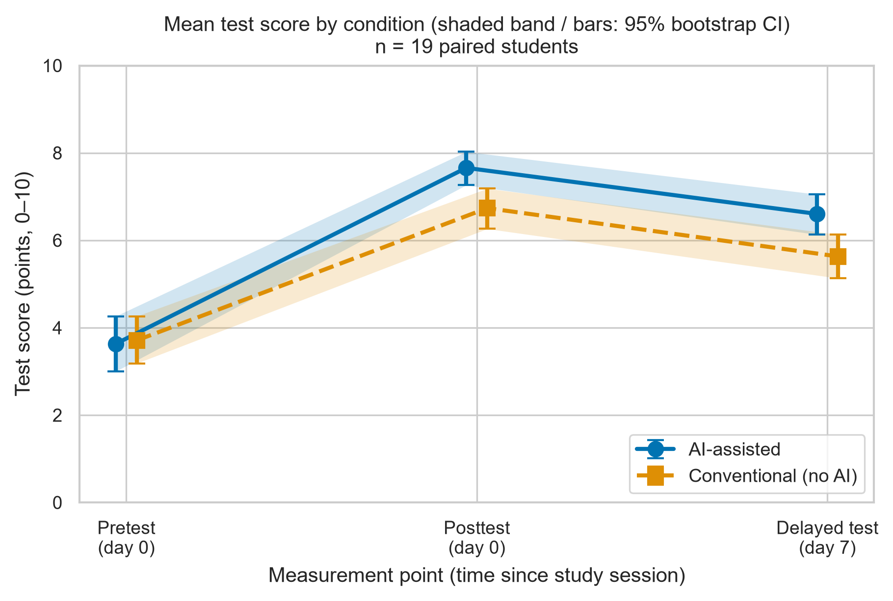
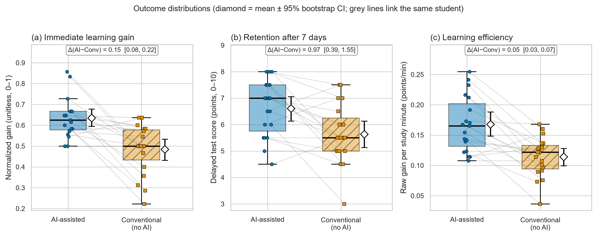
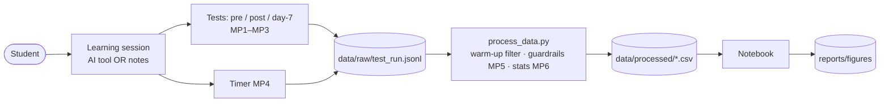

# Effectiveness of Generative AI Tools for University Students' Understanding of Academic Material

**Authors:** Mukhambet Asylzhan, Muktarhanuly Olzhas  **Institution:** Narxoz University, Kazakhstan
**Repository:** https://github.com/Asylzhan579/ai-learning-effectiveness-narxoz  **Release:** `v1.0-task3`

> ⚠️ **Data status.** `data/raw/test_run.jsonl` is a **synthetic placeholder** (80 simulated records, seed 42, no real students) used to verify the analysis
> pipeline. Results below demonstrate the method and are **not** empirical findings. Replace the file with real, pseudonymised records (same schema) and re-run.

## Overview and research questions
Randomized, counterbalanced **crossover** study with **20 Narxoz undergraduates**: every student studies one module with generative-AI support and a matched module with
conventional resources (lecture notes / textbook). Analysis is performed on within-student paired differences (AI − Conventional).

| RQ | Outcome | H0 | H1 |
|---|---|---|---|
| **RQ1 (primary)** | Normalized immediate gain `(post − pre)/(10 − pre)` | μ<sub>Δ</sub> ≤ 0 | μ<sub>Δ</sub> > 0 |
| RQ2 | Day-7 delayed score (0–10) | μ<sub>Δ</sub> ≤ 0 | μ<sub>Δ</sub> > 0 |
| RQ3 | Learning efficiency (points per study minute) | μ<sub>Δ</sub> ≤ 0 | μ<sub>Δ</sub> > 0 |

## Repository structure
```
ai-learning-effectiveness-narxoz/
├── data/
│   ├── raw/test_run.jsonl            # raw records, split into warm-up and evaluation phases (SYNTHETIC sample)
│   ├── processed/metrics_summary.csv # cleaned + aggregated metrics (also paired_effects.csv, guardrail_report.json, excluded_records.csv)
│   └── sample/pilot_synthetic.csv    # (TASK 2) 8-row smoke-test data
├── docs/
│   ├── domain_model.md               # C4 diagrams with metric collection points + LaTeX metric definitions
│   └── Methodology_Passport_Card.md  # (TASK 1/2)
├── notebooks/01_data_analysis.ipynb  # executed top-to-bottom, outputs preserved, seed 42
├── reports/
│   ├── Task3_Report.md               # report for the LMS
│   └── figures/                      # fig1_latency_vs_load / fig2_distribution_boxplot  (.pdf + .png 300 DPI)
├── src/
│   ├── process_data.py               # warm-up filter, guardrails, statistics (bootstrap CI, percentiles, paired tests)
│   ├── visualize.py                  # publication-ready figures
│   ├── generate_sample_data.py       # reproducible synthetic data generator
│   └── benchmark.py                  # (TASK 2) smoke-test benchmark
├── configs/                          # config.json (TASK 2), task3_config.json (TASK 3)
├── tests/                            # unit tests (unittest)
├── .gitignore  requirements.txt  Dockerfile  LICENSE  README.md
```

## Quickstart (TASK 3)
```bash
python -m venv .venv && source .venv/bin/activate      # Windows: .venv\Scripts\activate
pip install -r requirements.txt
python -m unittest discover -s tests -v                 # 7 unit tests
python -m src.process_data --config configs/task3_config.json   # statistics -> data/processed/
python -m src.visualize                                 # figures -> reports/figures/
jupyter lab notebooks/01_data_analysis.ipynb            # Kernel -> Restart & Run All
```
Optional: `python -m src.generate_sample_data` regenerates the synthetic sample (deterministic, seed 42).

**TASK 2 smoke test (standard library only, Docker):** `docker build -t narxoz-ai-study . && docker run --rm narxoz-ai-study`

## Methods in brief
1. **Ingestion & warm-up filtering.** Raw `.jsonl` → warm-up (practice-session) runs are discarded; only `phase = evaluation` is analysed.
2. **Guardrails.** Required fields present, scores ∈ [0, 10], study time ∈ (0, 30] min, delayed test exactly 7 days; violations are reported as an **error rate** (never silently dropped); ceiling pretests (= 10) excluded by a predefined rule.
3. **Statistics.** Median, p25–p75, p95, p99, mean ± SD, **percentile-bootstrap 95% CI** (10 000 resamples, seed 42); paired difference with bootstrap CI, Cohen's d<sub>z</sub>, paired t-test, sign-flip permutation test, Wilcoxon (one-sided for RQ1–RQ3).
4. **Visualization.** Axis titles with units, 95% CI bands/error bars, colour-blind palette + distinct line styles/markers/hatches, export to vector PDF and 300-DPI PNG.

## Results & Discussion

### Benchmark summary (Baseline = Conventional vs Proposed = AI-assisted; n = 19 paired students)
| Metric | Baseline: Conventional, mean ± SD | Proposed: AI-assisted, mean ± SD | Baseline: median (p25–p75) | Proposed: median (p25–p75) | Paired Δ (AI − Conv) [95% bootstrap CI] | p (permutation) |
|---|---|---|---|---|---|---|
| Normalized immediate gain (unitless) — **RQ1, primary** | 0.48 ± 0.12 | 0.63 ± 0.10 | 0.50 (0.43–0.58) | 0.62 (0.58–0.67) | +0.15 [+0.08, +0.22] | 0.0001 |
| Day-7 delayed score (points, 0–10) — RQ2 | 5.63 ± 1.13 | 6.61 ± 1.06 | 5.50 (5.00–6.25) | 7.00 (5.75–7.50) | +0.97 [+0.39, +1.55] | 0.0032 |
| Learning efficiency (points/min) — RQ3 | 0.114 ± 0.033 | 0.168 ± 0.046 | 0.122 (0.094–0.133) | 0.165 (0.131–0.202) | +0.054 [+0.032, +0.075] | 0.0001 |
| Study time (min) — descriptive | 26.6 ± 1.3 | 24.2 ± 1.7 | 27.0 (25.7–27.6) | 24.2 (23.1–25.4) | -2.5 [-3.5, -1.4] | 0.0005 (two-sided) |

### Tail percentiles and median CI
| Metric | Condition | n | p95 | p99 | Median 95% bootstrap CI |
|---|---|---|---|---|---|
| norm_gain | Conventional | 19 | 0.64 | 0.64 | [0.47, 0.57] |
| norm_gain | AI | 19 | 0.84 | 0.85 | [0.58, 0.67] |
| delayed_score | Conventional | 19 | 7.50 | 7.50 | [5.00, 6.00] |
| delayed_score | AI | 19 | 8.00 | 8.00 | [6.00, 7.50] |
| efficiency | Conventional | 19 | 0.161 | 0.167 | [0.097, 0.130] |
| efficiency | AI | 19 | 0.243 | 0.252 | [0.139, 0.192] |
| study_time_min | Conventional | 19 | 28.1 | 28.5 | [25.8, 27.4] |
| study_time_min | AI | 19 | 26.4 | 27.5 | [23.1, 25.1] |

### Guardrail metrics
| Guardrail | Rule | Result |
|---|---|---|
| Warm-up phase | `phase = warmup` records discarded before statistics | 40 of 80 raw records discarded |
| Error rate (overall) | invalid / checked evaluation records ≤ 5% | **2.5%** (1/40) → OK |
| Error rate by condition | AI / Conventional | 5.0% / 0.0% |
| Ceiling pretest (= 10) | excluded (normalized gain undefined) | 0 records |
| Complete pairs analysed | both conditions valid | **19** students |

### Figures

*Fig. 1 — Mean test score at pretest, posttest and day-7 test per condition; shaded band and bars = 95% bootstrap CI. (File name follows the TASK 3 template; the "load" axis is the measurement stage.) Vector version: `reports/figures/fig1_latency_vs_load.pdf`.*


*Fig. 2 — Distributions of normalized gain, retention and efficiency; dots = students, grey lines = pairing, ◇ = mean ± 95% bootstrap CI. Vector version: `reports/figures/fig2_distribution_boxplot.pdf`.*

### Discussion
In this **synthetic** run the AI-assisted condition shows a higher normalized immediate gain than the conventional baseline
(paired Δ = +0.15, 95% bootstrap CI [+0.08, +0.22], d<sub>z</sub> = 0.97), higher day-7 retention
(Δ = +0.97 points, CI [+0.39, +1.55]) and higher efficiency
(Δ = +0.054 points/min, CI [+0.032, +0.075]) with ≈ 2.5 min less study time. All three confidence intervals exclude 0,
i.e. the directional hypotheses H1 (RQ1–RQ3) would be supported *if these were real data*. They are not: the effect sizes were generated by the simulator and exist only to
verify that the pipeline (warm-up filtering → guardrails → bootstrap CI → paired tests → figures) works end-to-end. After the real Week 7–8 data are collected, replace
`data/raw/test_run.jsonl` and re-run the notebook; all tables and figures are regenerated automatically.

*Interpretation rules used:* a CI that excludes 0 supports the *direction* of H1; secondary outcomes (RQ2, RQ3) are not corrected for multiplicity; p95/p99 with n = 19 are tail estimates of a very small sample;
an exploratory order check (notebook §6) should be repeated on real data before any causal claim.

## Domain model
Full artifact: **[`docs/domain_model.md`](docs/domain_model.md)** (C4 container + component diagrams with metric collection points MP1–MP6, metric catalogue, LaTeX definitions and notation table). Compact view:



## Operationalization and limitations
Independent variable: study condition (AI-assisted vs conventional); design factors `sequence`, `module`, `period` are recorded. Dependent variables: normalized gain, day-7 score, efficiency, study time.
Small sample (n = 20 planned), single university, two modules; carry-over is assumed absent and only checked exploratorily; secondary outcomes are not multiplicity-adjusted;
the current data are synthetic. Association supports a causal reading only if randomisation/counterbalancing are actually followed.

**Research ethics:** consent obtained, no names or private chat transcripts collected, identifiers separated from measurements and anonymised (`Pxx`). Never commit identifiable student records (see `.gitignore`).

## Citation and license
*Asylzhan M., Muktarkhanuly O. (2026). Effectiveness of Generative AI Tools for University Students' Understanding of Academic Material: research repository. GitHub.*
Code: MIT License. Student data may be shared only under a separate consent/data-use policy.
