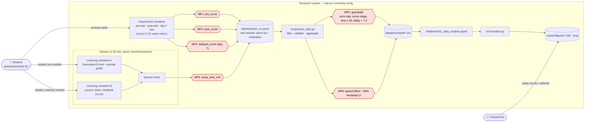
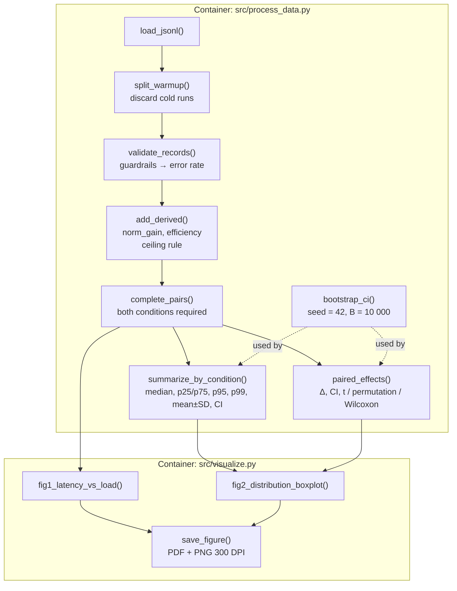

# Domain Model (Week 9) — Research track: Software Engineering (C4) + formal metric notation

This document formalises **what is measured, where, and how** in the crossover study
*"Effectiveness of Generative AI Tools for University Students' Understanding of Academic Material"*.
It contains (1) a **C4 Container diagram** with the **metric collection points** highlighted,
(2) a **C4 Component diagram** of the analysis pipeline, (3) a **metric catalogue** and
(4) **LaTeX definitions** with a notation table.

> Legend: **MP1–MP6 = Metric collection Points** (red/orange nodes in the diagram).

---

## 1. C4 — Level 2: Container diagram (with metric collection points)

### Metric collection points

| ID  | Where in the system | What is recorded | Unit / range | Field in `test_run.jsonl` |
|-----|---------------------|------------------|--------------|---------------------------|
| MP1 | Assessment container, before study | Pre-test score (prior understanding) | points, 0–10 | `pre_score` |
| MP2 | Assessment container, right after study | Immediate post-test score | points, 0–10 | `post_score` |
| MP3 | Assessment container, **exactly day 7** | Delayed (retention) score | points, 0–10 | `delayed_score`, `delayed_interval_days` |
| MP4 | Session timer | Actual time on task | minutes, (0, 30] | `study_time_min` |
| MP5 | `process_data.validate_records` | **Guardrail metric:** error rate of invalid records | share, 0–1 | `data/processed/guardrail_report.json` |
| MP6 | `process_data.paired_effects` | Paired difference AI − Conventional + 95% bootstrap CI | metric units | `data/processed/paired_effects.csv` |

**Warm-up (cold-start) phase.** Each student first completes a *practice* session (module `P`, `phase = "warmup"`)
with each tool to remove interface-unfamiliarity effects (analogue of "cold-start spikes" in benchmarking).
Warm-up records are stored, but **discarded before any statistics** (`process_data.split_warmup`).

---

## 2. C4 — Level 3: Component diagram of the analysis container

---

## 3. Metric catalogue (aligned with the Methodology Passport Card)

| Role | Metric | Definition | Unit | RQ |
|------|--------|-----------|------|----|
| **Primary** | Normalized immediate gain | $g = \dfrac{post - pre}{S_{max} - pre}$ | unitless | RQ1 |
| Secondary | Day-7 delayed score | $d$ | points (0–10) | RQ2 |
| Secondary | Learning efficiency | $e = \dfrac{post - pre}{t}$ | points / min | RQ3 |
| Descriptive | Study time | $t$ | min | — |
| **Guardrail** | Error rate | $\rho = \dfrac{N_{invalid}}{N_{checked}}$, required $\rho \le 0.05$ (target 0 for real data) | share | all |

---

## 4. Formal definitions (LaTeX)

**Paired difference** for student $i$ and metric $m \in \{g, d, e\}$:

$$\Delta_i^{(m)} = m_i^{\text{AI}} - m_i^{\text{Conv}}, \qquad \bar\Delta^{(m)} = \frac{1}{n}\sum_{i=1}^{n}\Delta_i^{(m)}$$

**Hypotheses** (directional, from the Passport Card):

$$H_0:\ \mu_\Delta \le 0 \qquad\text{vs}\qquad H_1:\ \mu_\Delta > 0$$

**Paired t-statistic** and **effect size** (Cohen's $d_z$):

$$t = \frac{\bar\Delta}{s_\Delta/\sqrt{n}}, \qquad d_z = \frac{\bar\Delta}{s_\Delta}$$

**Percentile bootstrap 95% CI** (resampling students with replacement, $B = 10\,000$, seed $=42$):

$$\mathrm{CI}_{95\%} = \Big[\ Q_{0.025}\big(\{\bar\Delta^{*}_b\}_{b=1}^{B}\big),\ \ Q_{0.975}\big(\{\bar\Delta^{*}_b\}_{b=1}^{B}\big)\ \Big]$$

**Sign-flip permutation p-value** (one-sided), with $\varepsilon_i \in \{-1,+1\}$ i.i.d. Rademacher signs:

$$p = \frac{1 + \#\{\,b : \bar\Delta^{(b)}_{\varepsilon} \ge \bar\Delta_{obs}\,\}}{B_{perm} + 1}, \qquad \bar\Delta^{(b)}_{\varepsilon} = \frac{1}{n}\sum_i \varepsilon_i^{(b)}\Delta_i$$

**Ceiling rule** (predefined): records with $pre = S_{max}$ are excluded because $g$ is undefined.

### Notation table

| Symbol | Meaning | Unit / domain |
|--------|---------|---------------|
| $i = 1,\dots,n$ | Student index (pseudonymised ID `Pxx`) | $n = 20$ planned |
| $c \in \{\text{AI},\text{Conv}\}$ | Study condition | categorical |
| $S_{max}$ | Maximum test score | 10 points |
| $pre_i^{c},\ post_i^{c}$ | Pre-/post-test score of student $i$ in condition $c$ | points, $[0, S_{max}]$ |
| $d_i^{c}$ | Delayed test score at day 7 | points, $[0, S_{max}]$ |
| $t_i^{c}$ | Study time | min, $(0, 30]$ |
| $g_i^{c}$ | Normalized immediate gain | $[0,1]$ (can be $<0$) |
| $e_i^{c}$ | Learning efficiency | points/min |
| $\Delta_i^{(m)}$ | Paired difference AI − Conv for metric $m$ | metric units |
| $\bar\Delta,\ s_\Delta$ | Mean and SD of paired differences | metric units |
| $\mu_\Delta$ | Population mean paired difference | metric units |
| $B,\ B_{perm}$ | Bootstrap / permutation replicates | 10 000 / 20 000 |
| $Q_q$ | $q$-th quantile | — |
| $\rho$ | Guardrail error rate | share, $[0,1]$ |
| $\alpha$ | Significance level | 0.05 |

> Threats to validity tracked by the model: carry-over between periods, module difficulty (A vs B), order effect —
> they are recorded as design factors (`sequence`, `module`, `period`) and will be checked before inferential claims.
