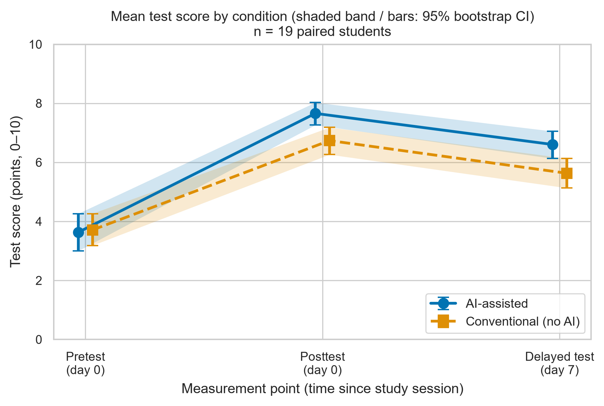
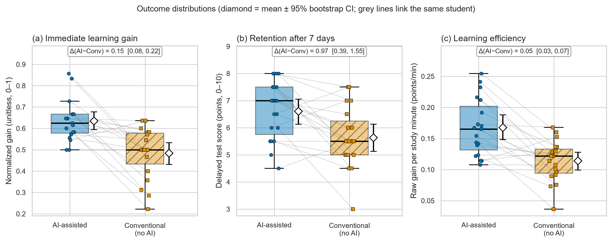

# TASK 3 — Research Results, Data Analysis and Scientific Visualization

**Course:** Research Methodology  **Authors:** Mukhambet Asylzhan, Muktarhanuly Olzhas (Narxoz University)
**Repository:** https://github.com/Asylzhan579/ai-learning-effectiveness-narxoz (release `v1.0-task3`)

> **Data status:** the analysed file is a **synthetic placeholder** (simulated, seed 42) used to validate the pipeline; numbers illustrate the method, not real findings.

## 1. Goal
Finalize the practical phase: process raw logs (warm-up vs evaluation), compute statistics with bootstrap 95% CI, build a formal domain model, produce publication-ready figures and release a reproducible repository.

## 2. Method
* **Data:** `data/raw/test_run.jsonl` — 80 records = 20 students × (2 warm-up + 2 evaluation sessions); crossover AI vs conventional, 4 counterbalanced sequences.
* **Warm-up filtering:** practice sessions (`phase = warmup`) discarded before any statistics (they show longer, erratic study time and lower gain).
* **Guardrails:** missing fields, score range [0, 10], time ≤ 30 min, delay = 7 days; violations reported as error rate; ceiling-pretest rule.
* **Statistics:** median, p25/p75, p95, p99, mean ± SD; percentile bootstrap 95% CI (B = 10 000); paired Δ with CI, dz, paired t, permutation, Wilcoxon; seed 42.
* **Domain model (SE track):** C4 container/component diagrams with metric collection points + LaTeX definitions — `docs/domain_model.md`.

## 3. Results (n = 19 paired students)
| Metric | Baseline: Conventional, mean ± SD | Proposed: AI-assisted, mean ± SD | Baseline: median (p25–p75) | Proposed: median (p25–p75) | Paired Δ (AI − Conv) [95% bootstrap CI] | p (permutation) |
|---|---|---|---|---|---|---|
| Normalized immediate gain (unitless) — **RQ1, primary** | 0.48 ± 0.12 | 0.63 ± 0.10 | 0.50 (0.43–0.58) | 0.62 (0.58–0.67) | +0.15 [+0.08, +0.22] | 0.0001 |
| Day-7 delayed score (points, 0–10) — RQ2 | 5.63 ± 1.13 | 6.61 ± 1.06 | 5.50 (5.00–6.25) | 7.00 (5.75–7.50) | +0.97 [+0.39, +1.55] | 0.0032 |
| Learning efficiency (points/min) — RQ3 | 0.114 ± 0.033 | 0.168 ± 0.046 | 0.122 (0.094–0.133) | 0.165 (0.131–0.202) | +0.054 [+0.032, +0.075] | 0.0001 |
| Study time (min) — descriptive | 26.6 ± 1.3 | 24.2 ± 1.7 | 27.0 (25.7–27.6) | 24.2 (23.1–25.4) | -2.5 [-3.5, -1.4] | 0.0005 (two-sided) |

| Metric | Condition | n | p95 | p99 | Median 95% bootstrap CI |
|---|---|---|---|---|---|
| norm_gain | Conventional | 19 | 0.64 | 0.64 | [0.47, 0.57] |
| norm_gain | AI | 19 | 0.84 | 0.85 | [0.58, 0.67] |
| delayed_score | Conventional | 19 | 7.50 | 7.50 | [5.00, 6.00] |
| delayed_score | AI | 19 | 8.00 | 8.00 | [6.00, 7.50] |
| efficiency | Conventional | 19 | 0.161 | 0.167 | [0.097, 0.130] |
| efficiency | AI | 19 | 0.243 | 0.252 | [0.139, 0.192] |
| study_time_min | Conventional | 19 | 28.1 | 28.5 | [25.8, 27.4] |
| study_time_min | AI | 19 | 26.4 | 27.5 | [23.1, 25.1] |

| Guardrail | Rule | Result |
|---|---|---|
| Warm-up phase | `phase = warmup` records discarded before statistics | 40 of 80 raw records discarded |
| Error rate (overall) | invalid / checked evaluation records ≤ 5% | **2.5%** (1/40) → OK |
| Error rate by condition | AI / Conventional | 5.0% / 0.0% |
| Ceiling pretest (= 10) | excluded (normalized gain undefined) | 0 records |
| Complete pairs analysed | both conditions valid | **19** students |

## 4. Discussion
In this **synthetic** run the AI-assisted condition shows a higher normalized immediate gain than the conventional baseline
(paired Δ = +0.15, 95% bootstrap CI [+0.08, +0.22], dz = 0.97), higher day-7 retention
(Δ = +0.97 points, CI [+0.39, +1.55]) and higher efficiency
(Δ = +0.054 points/min, CI [+0.032, +0.075]) with ≈ 2.5 min less study time. All three confidence intervals exclude 0,
i.e. the directional hypotheses H1 (RQ1–RQ3) would be supported *if these were real data*. They are not: the effect sizes were generated by the simulator and exist only to
verify that the pipeline (warm-up filtering → guardrails → bootstrap CI → paired tests → figures) works end-to-end. After the real Week 7–8 data are collected, replace
`data/raw/test_run.jsonl` and re-run the notebook; all tables and figures are regenerated automatically.

*Interpretation rules used:* a CI that excludes 0 supports the *direction* of H1; secondary outcomes (RQ2, RQ3) are not corrected for multiplicity; p95/p99 with n = 19 are tail estimates of a very small sample;
an exploratory order check (notebook §6) should be repeated on real data before any causal claim.

## 5. Reproducibility and repository hygiene
Notebook `notebooks/01_data_analysis.ipynb` is executed sequentially with preserved outputs; logic lives in `src/process_data.py` and `src/visualize.py`; figures exported as PDF + PNG (300 DPI);
`.gitignore` excludes `.ipynb_checkpoints/`, `__pycache__/`, `.venv/` and heavy raw dumps; 7 unit tests pass (`python -m unittest discover -s tests`).

## 6. Limitations
Small n, synthetic data, two modules, one university, unadjusted secondary outcomes, assumed absence of carry-over, tail percentiles from a tiny sample.
